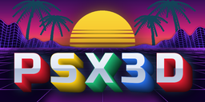
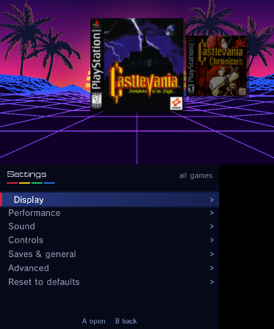
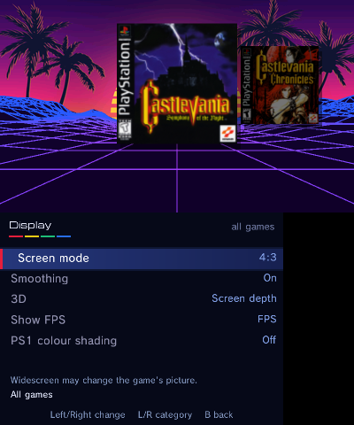
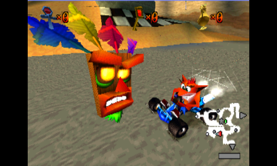
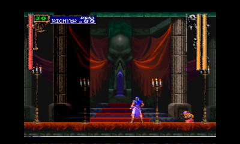
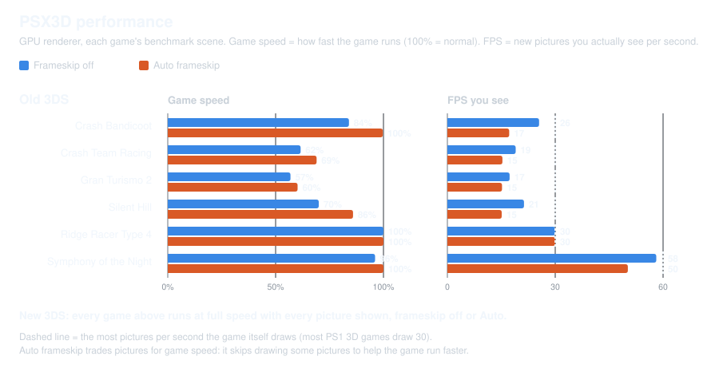

<p align="center"></p>

<h1 align="center">PSX3D</h1>
<p align="center">A standalone PlayStation emulator for Nintendo 3DS.</p>

<p align="center">
  <a href="https://github.com/BreadChaser/PSX3D/releases/latest"></a>
  <a href="https://github.com/BreadChaser/PSX3D/releases"></a>
  <a href="LICENSE"></a>
  
</p>

PSX3D runs PlayStation games on Old and New 3DS with GPU rendering, a box-art
library and per-game settings. It's built on PCSX-ReARMed and needs no
RetroArch and no BIOS file.

> **Work in progress.** Expect some drawing errors. New 3DS runs all the heaviest
> tested scenes at full speed; demanding games are slower on Old 3DS. Stereoscopic 3D is
> temporarily off while it's rebuilt for the GPU renderer.

## Screenshots

<table>
  <tr>
    <td align="center"><br>Library</td>
    <td align="center"><br>Pause menu</td>
  </tr>
  <tr>
    <td align="center"><br>Settings</td>
    <td align="center"><br>Display settings</td>
  </tr>
</table>

<p align="center"><br>Old 3DS touch controls</p>

<table>
  <tr>
    <td align="center"><br>Crash Team Racing</td>
    <td align="center"><br>Silent Hill</td>
    <td align="center"><br>Symphony of the Night</td>
  </tr>
</table>

## Features

- GPU rendering on Old and New 3DS, with smart frameskip
- Real widescreen for games with a tested widescreen fix
- Built-in game presets for each console, with per-game overrides
- Box art, clean titles and multi-disc grouping
- Save states with previews, memory cards, cheats and disc swapping
- Remappable buttons and touch controls; fast-forward, and rewind on New 3DS
- Built-in BIOS: no BIOS file needed

## Performance

<picture><source media="(prefers-color-scheme: light)" srcset="docs/performance-light.svg"></picture>

<details>
<summary>Exact numbers</summary>

Game speed: 100% = normal pace. FPS: new pictures shown per second (most 3D games
draw 30 or fewer in busy scenes; Symphony of the Night, Tekken 3 and Klonoa draw
60; Final Fantasy VII battles draw 15). Measured in each game's heaviest tested scene;
see [methodology](docs/performance.md).

<!-- perf-table -->
| Game | Console | Frameskip off: speed / FPS | Auto frameskip: speed / FPS |
|---|---|---:|---:|
| Crash Bandicoot | Old 3DS | 84.9% / 20.0 | 96.1% / 13.9 |
| Crash Bandicoot | New 3DS | 100.0% / 24.8 | 100.0% / 24.8 |
| Crash Bandicoot 2 | Old 3DS | 70.3% / 21.4 | 85.9% / 15.4 |
| Crash Bandicoot 2 | New 3DS | 100.0% / 30.2 | 100.0% / 30.2 |
| Crash Team Racing | Old 3DS | 75.4% / 22.3 | 85.2% / 15.1 |
| Crash Team Racing | New 3DS | 100.0% / 26.3 | 100.0% / 26.3 |
| Gran Turismo 2 | Old 3DS | 50.3% / 13.4 | 50.7% / 12.2 |
| Gran Turismo 2 | New 3DS | 99.9% / 24.8 | 99.9% / 24.8 |
| Ridge Racer Type 4 | Old 3DS | 78.2% / 23.9 | 86.5% / 16.6 |
| Ridge Racer Type 4 | New 3DS | 100.0% / 30.3 | 100.0% / 30.2 |
| Need for Speed: High Stakes | Old 3DS | 35.2% / 11.7 | 35.5% / 11.1 |
| Need for Speed: High Stakes | New 3DS | 99.8% / 38.4 | 100.0% / 38.0 |
| Tekken 3 | Old 3DS | 63.7% / 38.7 | 87.2% / 15.1 |
| Tekken 3 | New 3DS | 100.0% / 60.4 | 100.0% / 60.6 |
| Final Fantasy VII | Old 3DS | 100.0% / 15.2 | 100.0% / 15.2 |
| Final Fantasy VII | New 3DS | 100.0% / 15.1 | 100.0% / 15.1 |
| Klonoa | Old 3DS | 83.5% / 50.6 | 97.8% / 15.1 |
| Klonoa | New 3DS | 100.0% / 60.8 | 100.0% / 60.7 |
| Silent Hill (alley) | Old 3DS | 67.4% / 20.5 | 77.8% / 15.2 |
| Silent Hill (alley) | New 3DS | 100.0% / 29.7 | 100.0% / 29.7 |
| Silent Hill (café) | Old 3DS | 68.4% / 16.1 | 69.8% / 15.3 |
| Silent Hill (café) | New 3DS | 100.0% / 22.3 | 100.0% / 22.3 |
| Symphony of the Night | Old 3DS | 96.3% / 58.3 | 100.0% / 50.1 |
| Symphony of the Night | New 3DS | 100.0% / 60.7 | 100.0% / 60.8 |
<!-- /perf-table -->

</details>

## Install

You need a 3DS or 2DS with Luma3DS and your own game images.

In **FBI → Remote Install → Scan QR Code**, scan:

<p align="center"></p>

Or install [**PSX3D.cia**](https://github.com/BreadChaser/PSX3D/releases/latest/download/PSX3D.cia)
with FBI (a 3DSX for Homebrew Launcher is also on the release page).

Put games (`.cue/.bin`, `.chd`, `.pbp`, `.iso`, `.m3u`) in `sdmc:/roms/psx/`, or
press **Y** in the library to pick a folder. Box art downloads automatically.

## Controls

| Where | Input | Action |
|---|---|---|
| Library | A / Y / X | Play / choose folder / settings |
| In game | A / B / X / Y | Circle / Cross / Triangle / Square |
| In game | L / R / ZL / ZR | L1 / R1 / L2 / R2 |
| In game | Circle Pad / C-Stick | D-pad or left stick / right stick |
| In game | Touch MENU | Pause menu |

Everything can be remapped. Old 3DS gets extra buttons and a right stick on the
touch screen.

## Building

Needs devkitPro (devkitARM, libctru, citro2d, citro3d), makerom and bannertool.
See [building](docs/building.md).

```bash
git clone https://github.com/BreadChaser/PSX3D.git
cd PSX3D
make        # psx3d/PSX3D.3dsx
make cia    # psx3d/PSX3D.cia
```

## Credits and licence

- **BreadChaser**: PSX3D
- [PCSX-ReARMed](https://github.com/libretro/pcsx_rearmed): notaz, Exophase and
  libretro contributors; based on PCSX, PCSX-Reloaded and P.E.Op.S.
- The PCSX-ReARMed 3DS port authors; devkitPro (libctru, citro2d, citro3d)
- [DSP1](https://github.com/zoogie/DSP1) by zoogie; [artwork, fonts and cheat sources](tools/art/CREDITS.md)

Not affiliated with Sony, Nintendo or libretro. GPL-2.0, see [LICENSE](LICENSE).
