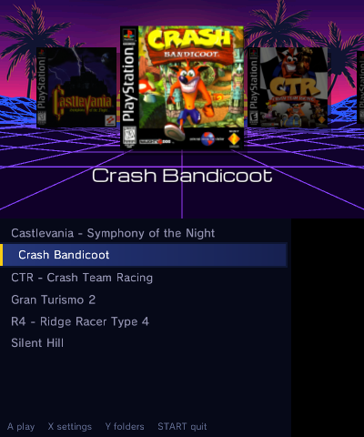
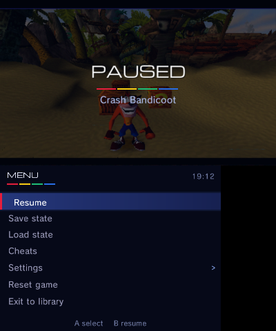
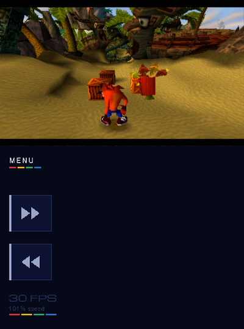
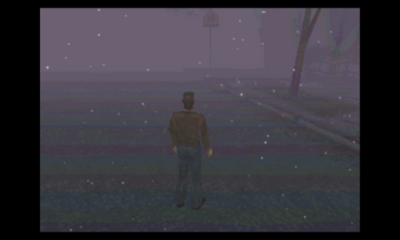
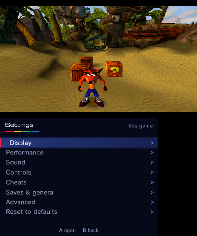
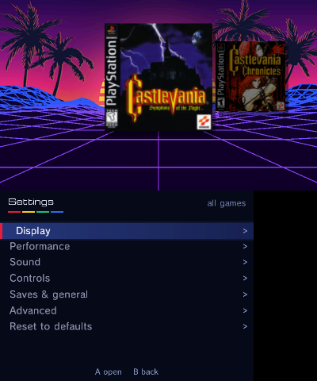
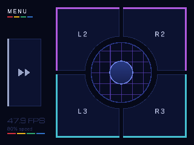

# PSX3D

PSX3D is a standalone PlayStation emulator for Nintendo 3DS by **BreadChaser**,
built around our vendored PCSX-ReARMed core and the gpu_pica GPU renderer. It runs without RetroArch.
This project is a work in progress.

**The first PS1 emulator for the 3DS that draws on the 3DS GPU.** On an Old 3DS
it runs games up to twice as fast as the PCSX-ReARMed software renderer used by
other 3DS PS1 emulators (historical v0.3.1 Crash Bandicoot: 49.1 FPS on GPU vs 22.8 on Software),
and automatic frameskip brings games like Crash Bandicoot, Ridge Racer Type 4
and Symphony of the Night to full game speed on the original 3DS.

> **The GPU renderer is experimental and still has drawing errors and missing effects.**
> Both console models now use GPU rendering exclusively.

<p align="center">
  
  
</p>
<p align="center">
  
  
</p>
<p align="center">
  
  
</p>
<p align="center">
  
</p>

## Features

- **GPU rendering on both Old and New 3DS.** No renderer setup is needed.
- Per-console game presets choose defaults and available features. Uncurated
  games expose all options supported by the console.
- Library with box art, clean titles, multi-disc grouping and large SD support
  without scanning the entire card.
- Ten save-state slots with picture previews, per-game memory cards, cheats and disc swapping.
- 4:3, stretched and widescreen display modes; stereo screen depth on New 3DS.
- Remappable controls, touch buttons and fast-forward/rewind hotkeys.
  **Old 3DS has no stereo 3D or rewind.**
- Smooth audio when slow, enabled by default on both consoles.
- Bottom-screen FPS readout; optional Detailed statistics.
- Global and per-game Reset to defaults.
- DSP firmware copied from the system on first start; DSP1 is not required.

## Performance

v0.4.0 candidate, measured on 2026-10-19 in six saved benchmark scenes,
using the GPU renderer on both consoles. Each run used a 10-second warmup and
15-second sample, clock 57, Old slot 2 / New slot 0. The consoles normally use
HLE BIOS; these gameplay tests load existing save states. These are scene
measurements, not whole-game compatibility guarantees. NTR was not explicitly
unloaded; the host observer reported no recent stream packets.

Frameskip-off numbers are emulated frames per second. Full speed is 60 FPS,
or 100% game speed; automatic frameskip shows fewer pictures to improve speed.

| Game | Old, off (FPS) | Old, auto (game speed) | New, off (FPS) | New, auto (game speed) |
|---|---:|---:|---:|---:|
| Crash Bandicoot | 53.0 | 100.0% | 60.0 | 100.0% |
| Crash Team Racing | 37.4 | 83.2% | 60.0 | 100.0% |
| Gran Turismo 2 | 34.4 | 79.0% | 60.0 | 100.0% |
| Silent Hill | 42.0 | 100.0% | 60.0 | 100.0% |
| Ridge Racer Type 4 | 60.0 | 100.0% | 60.0 | 100.0% |
| Castlevania: Symphony of the Night | 57.8 | 100.0% | 60.0 | 100.0% |

Automatic frameskip reaches full game speed in the tested Crash, Silent Hill,
R4 and Symphony of the Night scenes on Old 3DS. CTR and GT2 still run slowly.
All six New 3DS scenes hold about 60 FPS with frameskip off and auto.

Measurements, correctness gates and limitations: [candidate acceptance](docs/v040-candidate.md).
Changes: [v0.4.0 draft release notes](docs/release-notes-v0.4.0.md).

## Presets and settings

Games are recognised by their disc, and a built-in preset picks the best
settings for each game separately on Old and New 3DS. Games without a preset
show every option the console supports. Your own choices override the preset,
and **Reset to defaults** (global or per game) brings it back.
Castlevania: Symphony of the Night now uses GPU rendering on both consoles.

The library's **X** button opens the global settings; **Settings** in the pause
menu opens settings in the current game. Category pages group Display,
Performance, Sound, Controls, Saves & general, and Advanced options. Each row
shows whether it affects this game or all games; game overrides can be cleared
individually, and reset confirmations state what will be kept.

The bottom screen shows only what a game needs: on the Old 3DS a right stick
and L2/R2/L3/R3, on the New 3DS stick-click buttons for games that use them
(left or right side). Every touch button can be remapped per game. With nothing
to show, the bottom screen turns off. **Show FPS** can display the frame rate in
the corner, or detailed statistics.

## Requirements

- A 3DS or 2DS running Luma3DS. New 3DS performs best; demanding Old 3DS games
  still run below full speed, even with frameskip.
- Your game images: `.cue/.bin`, `.chd`, `.pbp`, `.iso` or `.m3u`. No games included.
- Optional BIOS (for example `scph1001.bin`) in `sdmc:/3ds/PSX3D/bios/`.
  The built-in HLE BIOS is the normal configuration and needs no BIOS file.
  Compatibility varies; a real BIOS can help with some games.

## Install

In **FBI → Remote Install → Scan QR Code**, scan this code to install the latest
release. It always points to the release asset named **PSX3D.cia**.


Alternatively, download [PSX3D.cia](https://github.com/BreadChaser/PSX3D/releases/latest/download/PSX3D.cia)
and install it with FBI. Place games in `sdmc:/roms/psx/`, or press **Y** in the
library to choose another folder. A 3DSX is also available for Homebrew Launcher.

## Controls

| Context | Input | Action |
|---|---|---|
| Library | A / Y / SELECT / X | Start / choose folder / rescan / settings |
| Library | START | Exit |
| In game | A / B / X / Y | Circle / Cross / Triangle / Square |
| In game | L / R / ZL / ZR | L1 / R1 / L2 / R2 |
| In game | Circle Pad / C-Stick | D-pad or left analog / right analog |
| In game | SELECT+R / SELECT+L | Fast-forward toggle / rewind hold, when available |
| In game | Touch MENU, or blank bottom screen | Pause menu |
| In game | Touch controls | Mapped game buttons |

Hotkeys are remappable. Rewind needs a New 3DS and is turned on per game.

## Box art and files

Box art downloads from [libretro-thumbnails](https://github.com/libretro-thumbnails/libretro-thumbnails)
and is cached in `sdmc:/3ds/PSX3D/covers/`. Covers load automatically on both
console models, including developer remote sessions; downloads pause before
gameplay. Custom PNGs can use the matching
filename. Internet is needed only for initial downloads.

| Under `sdmc:/3ds/PSX3D/` | Contents |
|---|---|
| `saves/` | Memory cards |
| `states/` | Save states |
| `covers/` | Box art |
| `bios/` | Optional BIOS |
| `config.ini`, `games/` | Global settings and per-game overrides |
| `log.txt` | Most recent session log |

## Known issues

- **The GPU renderer still has many issues:** drawing errors, missing effects
  and flicker in some games; one mask-checking blend mode is approximate.
  Report affected games so the GPU renderer can be improved.
- Display centering and interlaced modes are not implemented.
- Real per-object 3D currently falls back to depth-mesh screen 3D on New 3DS
  until GPU stereoscopic rendering lands.
- Demanding 3D games run below full speed on Old 3DS.
- Heavy Wi-Fi traffic and slow cover downloads can cause audio clicks.

When reporting a problem, include the affected session's `log.txt`.

## Building

Requires devkitPro/devkitARM, libctru, citro2d, citro3d, makerom and bannertool.
The GPU renderer and all core dependencies are included; no submodule, patch step
or renderer build flag is needed. Core changes are committed directly under
`core/`. See [core ownership and verification](docs/vendor-core.md).

```bash
git clone https://github.com/BreadChaser/PSX3D.git
cd PSX3D
make        # psx3d/PSX3D.3dsx
make cia    # psx3d/PSX3D.cia
```

## Credits

- **BreadChaser** — PSX3D author.
- [PCSX-ReARMed](https://github.com/libretro/pcsx_rearmed): notaz, Exophase
  and libretro contributors; based on PCSX, PCSX-Reloaded and P.E.Op.S.
- The authors of the PCSX-ReARMed 3DS port.
- devkitPro: libctru, citro2d and citro3d.
- [DSP1](https://github.com/zoogie/DSP1) by zoogie: firmware-copying method.
- [Artwork and fonts](tools/art/CREDITS.md).

PSX3D is not affiliated with Sony, Nintendo, libretro or the PCSX-ReARMed developers.
GPL-2.0, matching PCSX-ReARMed. See [LICENSE](LICENSE).
