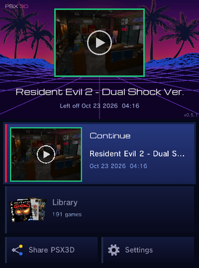

<p align="center"></p>

<h1 align="center">PSX3D</h1>
<p align="center"><b>A PlayStation emulator built for the Nintendo 3DS.</b><br>
GPU rendering, a box-art library and settings tuned for every tested game.</p>

<p align="center">
  <a href="https://github.com/BreadChaser/PSX3D/releases/latest"></a>
  <a href="https://github.com/BreadChaser/PSX3D/releases"></a>
  <a href="LICENSE"></a>
  
</p>

<p align="center">
  <a href="#install">Install</a> ·
  <a href="#controls">Controls</a> ·
  <a href="#performance">Performance</a> ·
  <a href="#faq">FAQ</a> ·
  <a href="https://github.com/BreadChaser/PSX3D/issues/new/choose">Report a problem</a>
</p>

<table>
  <tr>
    <td align="center"><br><sub>Main menu</sub></td>
    <td align="center"><br><sub>Library</sub></td>
    <td align="center"><br><sub>Crash Bandicoot on Old 3DS</sub></td>
  </tr>
</table>

PSX3D plays PlayStation games on every 3DS and 2DS. It draws with the 3DS
graphics chip, opens straight into your game library, and applies the right
settings for each tested game on your console. No BIOS file, no setup.

> [!NOTE]
> PSX3D is a work in progress and improves with every release. Most games run
> well; demanding 3D games run slower on the Old 3DS. See
> [Performance](#performance) and [Known issues](#known-issues).

## Features

**Plays well**
- Hardware (GPU) rendering on Old and New 3DS
- Tested settings per game and per console, applied automatically
- Auto frameskip that keeps games at full speed where it can
- Widescreen in games with a tested widescreen fix
- Fast forward in every game
- Built-in BIOS: a BIOS file is optional

**Easy to use**
- Main menu with **Continue**: back in your game in one press
- Box-art library with recently played games, favourites, sorting and a letter jump
- Box art downloads by itself; clean titles; multi-disc games grouped
- Finds your games on the SD card without any setup

**Keeps your progress safe**
- Your place is saved when you quit, when the 3DS sleeps and every few minutes
- Save states with previews
- The last ten automatic saves and dated memory card copies are kept per game
- **Undo** in the pause menu takes back the last load, save or reset

**And more**
- Cheats, disc swapping, remappable buttons
- Touch-screen L2/R2 for the Old 3DS, plus a right stick in analog games

### New 3DS extras

- **3D**: raise the 3D slider and the picture sits behind the screen.
  **Real 3D** (experimental, Settings → Display → 3D) gives every object its own
  depth; it slows busy scenes.
- **Rewind**: hold SELECT + L to go back a few seconds.
- **Faster PS1 processor** for games that slowed down on a real PlayStation
  (Crash Team Racing, Gran Turismo 2, Silent Hill, Need for Speed: High Stakes).

## Install

**You need** a 3DS or 2DS with [Luma3DS](https://github.com/LumaTeam/Luma3DS)
custom firmware, and your own PlayStation game images.

1. Open **FBI → Remote Install → Scan QR Code** and scan this code:

   

   Or download [**PSX3D.cia**](https://github.com/BreadChaser/PSX3D/releases/latest/download/PSX3D.cia)
   and install it with FBI.
2. Copy your games to `sdmc:/roms/psx/`.
3. Start **PSX3D** from the HOME Menu.

To update, scan the same code again. A `.3dsx` for the Homebrew Launcher is on
the [release page](https://github.com/BreadChaser/PSX3D/releases/latest).

## Getting started

**Games.** PSX3D reads `.cue/.bin`, `.chd`, `.pbp`, `.iso`, `.img`, `.mdf` and
`.m3u`. It looks in `sdmc:/roms/psx/` and other common folders; to use another
folder, pick it in **Settings → Games folder**. Press SELECT in the library to
scan again after adding games.

**Box art** downloads automatically, even for files with unusual names. To use
your own picture, see [box art](docs/box-art.md).

**BIOS.** Not needed. If you have a real PlayStation BIOS, copy it to
`sdmc:/3ds/PSX3D/bios/` and PSX3D uses it (`scph5500.bin`, `scph5501.bin`,
`scph5502.bin`, `scph1001.bin`, `scph7001.bin`, `scph101.bin` or
`psxonpsp660.bin`).

**Your files** live in `sdmc:/3ds/PSX3D/`:

| Folder or file | What it holds |
|---|---|
| `saves/` | Memory cards |
| `states/` | Save states and Continue |
| `backups/` | Save backups |
| `config.ini`, `games/` | Your settings |
| `log.txt` | What happened last session (older ones: `log.1.txt` to `log.4.txt`) |

## Controls

| Where | Button | Action |
|---|---|---|
| Main menu | A / X | Open / Settings |
| Library | A / X / Y | Play / Sort / Favourite |
| Library | L / R | Previous / next letter |
| Library | SELECT | Scan for new games |
| In game | A / B / X / Y | Circle / Cross / Triangle / Square |
| In game | L / R / ZL / ZR | L1 / R1 / L2 / R2 |
| In game | Circle Pad / C-Stick | D-pad or left stick / right stick |
| In game | Tap **MENU** (touch screen) | Pause menu |
| In game | SELECT + R | Fast forward on / off |
| In game | Hold SELECT + L | Rewind (New 3DS) |

Every button and both shortcuts can be changed in **Settings → Controls**.
The Old 3DS shows L2 and R2 on the touch screen, plus a right stick in analog games.

## Settings

Settings has four pages: **Display**, **Controls**, **Saves** and **Advanced**.
Open it from the main menu to change all games, or from the pause menu to
change only the game you are playing. Tested games already start with the best
values for your console, so most players never need Advanced. **Reset this
game** and **Reset all settings** put everything back.

## Performance

PSX3D is tuned hardest for the Old 3DS. Most games run at or near full speed
with Auto frameskip; demanding 3D games, such as racing games, run slower.

<picture><source media="(prefers-color-scheme: light)" srcset="docs/performance-light.svg"></picture>

<details>
<summary>Exact numbers</summary>

Old 3DS, heaviest tested scene of each game. Speed: 100% = full speed. Most PS1
3D games run at 30 FPS at most; Symphony of the Night, Tekken 3 and Klonoa at 60.
See [methodology](docs/performance.md) and [compatibility](docs/compatibility.md).

<!-- perf-table -->
| Game (Old 3DS) | Frameskip off: speed / FPS | Auto frameskip: speed / FPS |
|---|---:|---:|
| Crash Bandicoot | 91.2% / 22.1 | 98.4% / 17.1 |
| Crash Bandicoot 2 | 85.4% / 26.0 | 98.2% / 17.3 |
| Crash Team Racing | 80.8% / 23.9 | 91.7% / 15.1 |
| Gran Turismo 2 | 58.0% / 15.0 | 58.3% / 13.3 |
| Ridge Racer Type 4 | 85.0% / 25.8 | 91.9% / 18.7 |
| Need for Speed: High Stakes | 37.2% / 11.9 | 37.5% / 10.9 |
| Tekken 3 | 69.6% / 42.3 | 95.6% / 15.2 |
| Final Fantasy VII | 99.9% / 15.1 | 99.9% / 15.2 |
| Klonoa | 91.3% / 55.2 | 100.0% / 15.2 |
| Silent Hill (alley) | 76.8% / 23.3 | 90.5% / 15.2 |
| Silent Hill (café) | 80.1% / 18.9 | 86.7% / 15.2 |
| Symphony of the Night | 100.1% / 60.6 | 100.0% / 56.8 |
<!-- /perf-table -->

</details>

**New 3DS:** every game above runs at full speed in its heaviest tested scene
with Auto frameskip.

## Known issues

- Some games show drawing glitches, flicker or thin cracks at polygon edges.
- Demanding 3D games run below full speed on the Old 3DS.
- Real 3D (New 3DS) is experimental and slows busy scenes.
- European discs with LibCrypt protection need a matching `.sbi` file next to
  the disc image ([details](docs/presets.md#regions)).
- With the built-in BIOS, the first Gran Turismo hangs and Mega Man Legends 2
  goes black after the intro. A real BIOS fixes Gran Turismo.

Found something else? [Open an issue](https://github.com/BreadChaser/PSX3D/issues/new/choose)
and attach `log.txt` if you can.

## FAQ

**Old 3DS or New 3DS?**
Both are supported. The New 3DS runs every tested game at full speed with Auto
frameskip, and adds
3D, rewind and a faster PS1 processor. The Old 3DS runs most games well;
demanding 3D games are slower there.

**Which game files work?**
`.cue/.bin`, `.chd`, `.pbp`, `.iso`, `.img`, `.mdf` and `.m3u` for multi-disc
games. `.ccd` (CloneCD) images don't load; convert them to `.cue/.bin` or `.chd`.

**Why is it slow in Azahar or without Luma3DS?**
PSX3D's fast mode needs Luma3DS on a real console. Without it PSX3D still
starts, but much slower.

**Do I need a BIOS?**
No. A BIOS is built in. A real one is used automatically if you add it.

## Building from source

You need devkitPro (devkitARM, libctru, citro2d, citro3d), makerom and
bannertool. Full steps are in [docs/building.md](docs/building.md).

```bash
git clone https://github.com/BreadChaser/PSX3D.git
cd PSX3D
make        # psx3d/PSX3D.3dsx
make cia    # psx3d/PSX3D.cia
```

## Credits and licence

- **BreadChaser**: PSX3D
- [PCSX-ReARMed](https://github.com/libretro/pcsx_rearmed): notaz, Exophase and
  libretro contributors; based on PCSX, PCSX-Reloaded and P.E.Op.S.
- The PCSX-ReARMed 3DS port authors; devkitPro (libctru, citro2d, citro3d)
- [DSP1](https://github.com/zoogie/DSP1) by zoogie; [artwork, fonts and cheat sources](tools/art/CREDITS.md)

PSX3D is licensed under the [GPL-2.0](LICENSE). It is not affiliated with Sony,
Nintendo or libretro.
