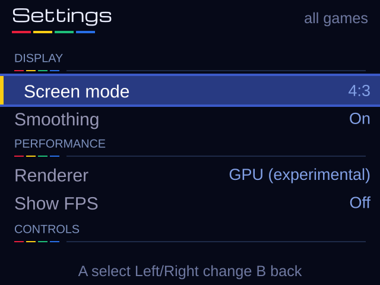
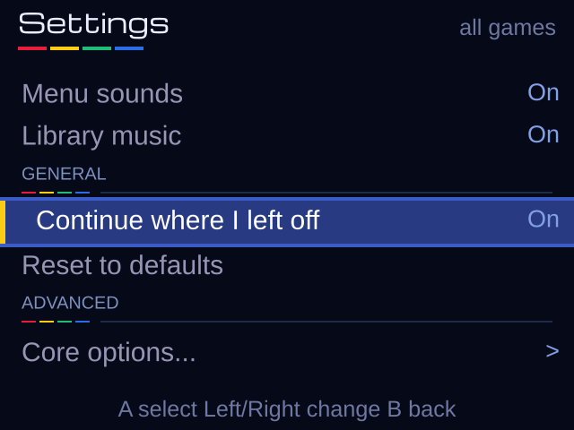
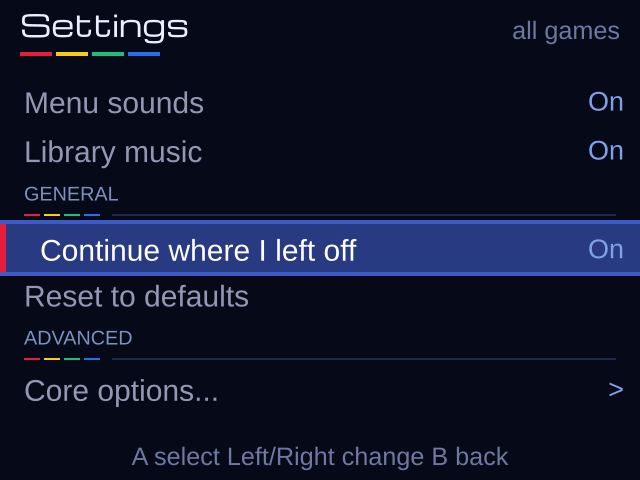
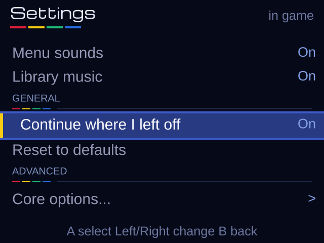

# Settings cleanup

Based on `10a5ac8` (`t3/fps-in-layout`). Frontend only; no console access or push.

## Before and after

The first cleanup (`7793779`) replaced the mixed lists with six category
subpages. This follow-up replaces those six subpages with **one scrolling list**
in both contexts. DISPLAY, PERFORMANCE, CONTROLS, SOUND, GENERAL and ADVANCED
are small, non-selectable headers with the app's four-colour bar and a divider.
Up/Down skips them, touch ignores them, and a header is inserted only after a
visible child is found, so empty sections disappear. Selection follows the same
setting when changing renderer, FPS mode or resetting changes row visibility.
B returns directly to the library or pause menu. Controls... and Core options...
remain child pages; B returns to their selected row in the settings list.
Left/Right changes values; A changes a value or opens a child page.

| Section, in scroll order | Library defaults | In-game settings |
| --- | --- | --- |
| DISPLAY | Screen mode, Smoothing, New 3DS 3D | Same |
| PERFORMANCE | Renderer, Software-only Half-height 3D (faster), Show FPS | Same |
| CONTROLS | Controls..., New 3DS Bottom-screen buttons | Same; side choice also hidden for blank layouts and Detailed stats |
| SOUND | Smooth audio when slow, Menu sounds, Library music | Same |
| GENERAL | Continue where I left off, Reset to defaults | Continue where I left off, New 3DS/preset-only Rewind, Reset to defaults |
| ADVANCED | Core options... | Core options...; audio recording/test tone only with debug=1 |

The pause menu remains Resume, Save state, Load state, Swap disc (multi-disc
only), Cheats, Settings, Reset game, Exit to library. It has seven entries for
single-disc games and eight for multi-disc games. Diagnostics stay in Advanced.

## Renamed and hidden frontend choices

| Before | After / visibility | Reason |
| --- | --- | --- |
| Screen (default) / Screen | Screen mode | Same plain name in both menus; header/help explains scope |
| 3D | New 3DS only | Old 3DS forces `stereo=0` on defaults/load/reset/sync; its core stereo option also always returns disabled, even with a test override |
| screen depth / real (exp.) | Screen depth / Full 3D (test) | Full 3D remains debug-only and Software-only; GPU shows effective Screen depth for an existing full-3D preference |
| 3D resolution: full / half (faster) | Half-height 3D (faster): Off / On, under Performance | Software-only polygon shortcut, unrelated to the 3D slider; hidden for GPU |
| Stick-click buttons: Right / Left | Bottom-screen buttons: Right side / Left side | New 3DS layout mirrors touch buttons, Menu, logo and FPS corner; Old 3DS ignores this setting |
| Controls | Controls... under the CONTROLS heading | Marks the remapping child page |
| Reset to global defaults (in game) | Reset to defaults | Help explicitly says it restores the game preset/library defaults and keeps saves/cheats/shared settings |
| Core options | Core options... | Marks the remaining Advanced child page |
| Renderer in Core options | Removed duplicate | Renderer lives only in Performance |
| Raw core stereo / widescreen (if registered) | Hidden | Frontend owns 3D and Screen mode; prevents duplicate controls |
| Debug: record audio / Debug: test tone | Advanced, debug=1 only | Troubleshooting, not normal player settings |

`Half-height 3D` is verified in `core/plugins/gpu_unai/gpulib_if.cpp`: it is
applied to polygon commands (`0x20..0x3f`). GPU rendering never consults it.
The frontend stereo field controls both menu/game second-eye rendering, so
forcing it off also prevents Old 3DS from drawing stereo UI. No separate stereo
quality control exists; the old resolution setting is not one, so none was
invented. New 3DS keeps its existing 3D modes.

The side setting is explicitly guarded by `g_new3ds` in `input.c` (button
positions, Menu/logo, stats tap corner) and `statsview.c` (FPS position). Old 3DS
mirrors none of these. In-game it is hidden when neither controls nor FPS are
visible, and in Detailed view, which has its own fixed layout. Library settings
keep it on New 3DS because they set the shared layout preference for other games.

## Advanced decision and inventory

Core options remain available without debug=1: BIOS selection, memory cards,
region, drawing timing, frame skipping and accuracy fixes can make a game boot,
restore missing effects, or correct a bad speed/compatibility choice. Hiding the
whole page would obstruct those fixes. Risky speed shortcuts keep their help
and warnings, with plain names. No emulation defaults were changed here, apart
from disabling stereo on Old 3DS.

The normal defaults expose 24 Old/GPU, 29 Old/Software, 23 New/GPU and 28
New/Software core choices. See [the generated exact inventory](core-inventory.tsv).
Conditional choices add rows when relevant. New visibility rules:

- Software drawing choices (older software drawing, transparency, lighting,
  faster lighting) and picture positioning are hidden for GPU.
- Manual sideways/up/down/height adjustments appear only for Manual position.
- The sound-buffer threshold appears only for Audio limit frame skipping.
- The skip limit disappears when frame skipping is Off.
- Extra core messages require debug=1.

Existing locks and exclusions still hide unused renderer plugins, lightguns,
rumble, multitap, mouse/steering controls, thread choices and redundant FPS
controls. Existing preset gates still decide rewind and remapping actions;
Old 3DS cannot enable rewind. Current preset metadata has no arbitrary
per-setting compatibility locks, so no untested game-specific restrictions
were added. In-game visibility uses the **running** renderer; a pending renderer
change takes effect after reopening the game. Library visibility uses the chosen
default renderer.

Core labels now read as follows; stored keys and values are unchanged:

| Core description before | Player name after |
| --- | --- |
| Region | Game region |
| BIOS Selection | BIOS |
| Memory Card 1 Type (Restart) | Memory card 1 |
| Memory Card 2 Type | Memory card 2 |
| CD read-ahead | Read disc ahead |
| PSX CPU Clock Speed (%) | Game CPU speed |
| Dithering Pattern | PS1 colour shading |
| Frameskip | Skip frames when slow |
| Frameskip Threshold (%) | Start skipping below |
| Frameskip Interval | Frames to skip at most |
| Display Informational Notifications | Debug: core messages |
| Framebuffer readout | Picture timing |
| (GPU) Slow linked list processing | Careful drawing order |
| (GPU) Screen centering | Picture position |
| (GPU) Manual position X | Move picture sideways |
| (GPU) Manual position Y | Move picture up or down |
| (GPU) Manual height adjustment | Adjust picture height |
| (GPU) Old renderer | Older software drawing |
| (GPU) Texture Blending | Transparency effects |
| (GPU) Lighting Effects | Lighting effects |
| (GPU) Fast Lighting | Faster lighting |
| Audio Reverb Effects | Sound echo |
| CD Audio | Disc music |
| XA Decoding | Disc voices and effects |
| Analog Axis Bounds | Stick response |
| DualShock Analog Mode Toggle Key Combo | Analog mode shortcut |
| Instruction Cache Emulation | Accurate CPU cache |
| Exception and Breakpoint Emulation | Accurate CPU errors |
| Turbo CD | Faster disc loading |
| Disable Automatic Compatibility Hacks | Disable automatic game fixes |
| (Hack) Disable Pipeline Delays | Simplify CPU loads |
| (Speed Hack) Disable SMC Checks | Skip code safety checks |
| (Speed Hack) Assume GTE Registers Unneeded | Faster 3D calculations |
| (Speed Hack) Disable GTE Flags | Simpler 3D clipping |
| Disable CPU/GTE Stalls | Simpler CPU timing |

Common displayed values are now On/Off/Auto, Audio limit/Always, Manual,
Game-controlled/No borders, Early/Late, Built-in, Game save/Per disc/Shared, and
Square/Round. These are labels only. Core value strings such as `enabled`,
`disabled`, `auto_threshold`, `fixed_interval` and `libretro` remain intact.
Long core values are no longer silently cut to 14 characters. Full labels and
all values in the normal inventory pass the host font-spacing check.

## Configuration compatibility

No keys were renamed and no migration is required. `stereo`, `half3d`,
`touch_click_left`, `renderer`, `stretch`, `smooth`, `show_fps`, `audio_stretch`,
`sounds`, `music`, `autosave`, `core.*`, mapping and hotkey keys still load/save
in their existing format. An Old 3DS ignores an old stereo enable and saves
`stereo=0`. Existing `half3d` and side preferences are preserved while hidden.

Setting scopes are unchanged: renderer, screen mode, remapping and rewind can
belong to the game. Other frontend choices and core options remain shared.
In-game help identifies shared settings. Per-game reset clears game overrides;
global reset keeps per-game overrides, saves, cheats and library paths.

## Old 3DS rewind audit

Every rewind reference in `psx3d/source` was inspected. Old 3DS does not expose
rewind or execute it, including with New 3DS config/per-game files. The existing
capability gate already covered the UI/input paths; this follow-up adds an
explicit early hardware guard inside the engine and regression tests.

| Checked location | Old 3DS result |
| --- | --- |
| [`presets.c`](../../psx3d/source/presets.c), `game_capabilities` | Uncurated default is off; final hardware clamp overrides even a preset with `rewind=1`. New 3DS still respects curated feature availability. |
| [`libui.c`](../../psx3d/source/libui.c), `settings_items` | Global list has no Rewind option on either model; rewind belongs to the game. |
| [`emu.c`](../../psx3d/source/emu.c), `menu_items`, `M_REWIND` action | Row omitted; action independently checks the capability. Pause menu has no rewind action. |
| [`input.c`](../../psx3d/source/input.c), `ps1_ids`, `input_map_cycle`, `touch_map_enabled` | Rewind remains a stable stored action ID, but cycling either direction skips it for every physical/touch slot. |
| `input.c`, `control_item` | Rewind side-slot row and Hotkey: rewind row omitted. |
| `input.c`, `input_control_value`, `input_control_color`, `input_controls_help` | Loaded forbidden physical bindings display none, touch bindings display Hide; no rewind label, colour or help is presented. |
| `input.c`, `touch_default_binding`, `touch_parts`, `touch_button_visible`, `touch_slot_held`, `touch_mask`, `touch_mark`, `touch_button_lit` | No default or remapped rewind touch button is drawn or hit-tested, in any slot. No PS1 mask bit is generated for an action ID. |
| `input.c`, `actions_update` | Rewind hotkey mask is zero, so SELECT+L does no rewind work and is not consumed; SELECT and L1 reach the PS1 normally. Physical/touch bindings to rewind are ignored. |
| `input.c`, `input_rewind`, `input_gameplay` | Capability gate prevents rewind input; entering/leaving gameplay clears held action state. |
| [`psx3d.h`](../../psx3d/source/psx3d.h), action IDs/API; `input.c`, `input_ps1_name`; [`ui.c`](../../psx3d/source/ui.c), rewind help/button symbols | Generic text/artwork retained for New 3DS; all callers that expose an action on Old are filtered as above. |
| [`config.c`](../../psx3d/source/config.c), `config_load`, `config_game_begin`, `config_controls_save`; [`gamecfg.c`](../../psx3d/source/gamecfg.c), load/get/set | Existing map/hotkey keys and per-game `rewind=1` remain portable; they cannot bypass the capability checks. A global `rewind` key is not a supported frontend setting. |
| `emu.c`, `emu_run_game` startup and capability-change handling | Stored `rewind=1` starts only when capability allows it. Active history is stopped if the capability disappears. |
| `emu.c`, gameplay loop / speed icon / Enable Rewind hint | All stepping, hint and icon paths require `input_rewind()`, which is false on Old. Capture calls are harmless while inactive. |
| [`rewind.c`](../../psx3d/source/rewind.c), `rewind_start` | Explicit `!g_new3ds` guard now runs before querying state size, allocating buffers or creating a worker, independent of the preset gate. |
| `rewind.c`, `rewind_capture`, `rewind_step`, `rewind_reset`, `rewind_stop`; `emu.c` state-load/reset/exit calls | Inactive guards prevent capture/stepping/work. Reset/stop calls do not start rewind. |

The host tests load New 3DS-style global and game files with `rewind=1`, rewind
bindings in physical and multiple touch slots, and `hotkey_rewind=SELECT+L`.
An explicitly rewind-enabled preset still cannot expose it on Old. Tests cover
all remap slots in both directions, hidden control rows/values/help/touch,
normal SELECT+L PS1 input, and the in-game setting filter. A separate test
compiles the actual rewind engine with host worker stubs: even with a deliberately
incorrect enabled capability on Old, serialization, allocation and worker counts
all stay zero. A New 3DS start/stop still works with the stub worker.

## Offline screenshots and validation

These use the production menu tables, visibility filters and drawing functions
through the existing bottom-screen host renderer. The title font is Michroma;
the system font is approximated with DejaVu Sans. They are **offline mockups**,
not hardware screenshots. Gallery section buttons show different **scroll
positions in the same list**. Only Controls... and Core options... open pages.
Old defaults to GPU; New defaults to Software.

| Context | Old 3DS | New 3DS |
| --- | --- | --- |
| Library list, top |  |  |
| In-game list, top |  |  |
| Library list, General |  |  |
| In-game list, General |  |  |

[Old Software library](old-global-Software.png) ·
[Old Software in game](old-game-Software.png) ·
[Interactive gallery](index.html)

Checks:

- `python3 tests/settings/run.py`: ASan/UBSan; production menu filters/drawing,
  model/renderer/preset visibility, blank/Detailed/FPS side visibility, disc/debug
  gating, conditional core rows, header-skipping navigation and wraparound,
  touch/header/footer exclusion at every scroll position, main selection
  restoration, full-label/value spacing, copied-SD rewind and engine tests,
  regenerated mockups.
- `bash tests/renderer_config.sh`: legacy config, renderers, Old stereo lock,
  New stereo persistence, per-game scopes and resets.
- `bash psx3d/tests/host/run.sh`: existing controls, presets, hotkeys, reset
  confirmation, touch layouts and FPS tests under ASan/UBSan.
- `source /home/tony/Development/PS1_3ds/devtools/env.sh && make -j16`.
- `make cia` with the supplied bannertool and makerom paths.

Both packages build. Existing path-truncation/unused-variable and executable-stack
warnings remain. No console interaction or hardware runtime validation was done.
See [validation and package hashes](validation.txt).
