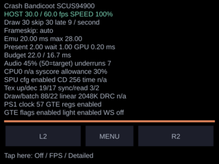

# Bottom-screen statistics

`show_fps=0/1/2` in `sdmc:/3ds/PSX3D/config.ini` selects Off, FPS,
or Detailed. Existing 0/1 files retain their meaning; invalid values become 0.
Choose Show FPS repeatedly, or tap the bottom 22-pixel stats/footer strip, to
cycle. Off is enabled again through the menu. On Old 3DS, Detailed moves the
L2, Menu and R2 controls into a 30-pixel row below the panel; their hitboxes move
with them. The game picture gets no new overlay. Configuration is saved on each
mode change (one SD write, outside the periodic rendering path).

## Numbers and sources

- Host FPS: outer emulation/presentation loop iterations divided by elapsed
  wall time (`osGetTime`), with target from libretro's AV timing (PAL/NTSC).
  This is host presentation throughput, not unique game images or LCD refreshes.
- Speed: **all** `retro_run` calls divided by wall time and the AV target.
  This includes fast-forward's extra calls. It measures emulated vblank rate,
  not how fast a game's internal logic runs under a PS1 clock hack. Rewind runs
  also count as emulated frames, so speed is not forward progress when rewinding.
- Draw/skip: emulated calls minus null libretro video callbacks / null callbacks;
  late is the existing deadline test in the main loop. Counts cover the sampled
  interval, normally one second (long frames can make it slightly longer).
  Frameskip mode is the effective `pcsx_rearmed_frameskip_type` option.
- Emu average/max: existing system-tick measurements around the emulation block,
  including its existing frontend work and fast-forward calls. Present and GPU
  wait use the existing presentation and `video_take_wait_ticks` counters.
  GPU ms/frame is `video_take_gpu_stats` divided by host presentation count;
  it describes the preceding completed GPU work and includes frontend rendering.
  The budget bar compares emu + present against `1000 / target`; GPU time overlaps
  CPU work and is deliberately not added again. Red means over budget.
- Audio: current `audio_occupancy` (50 is the queue target, **not** 50% of capacity),
  with interval underruns from `audio_stats`. Underruns count submissions finding
  an empty player, not a hardware interrupt count. No sound is labelled off.
- CPU0 load and helper-thread time: **n/a**, no cheap existing frontend accessor.
  Syscore allowance is `g_syscore_pct`, not measured utilization. SPU cfg and CD
  read-ahead show effective option values, not confirmation a thread is executing.
  On New 3DS, helper affinity can differ; the panel makes no CPU1 activity claim.
- Renderer: uploads, tile decodes, syncs, readbacks, primitives and batches from
  the existing `pica_stats` interval string. The one shared read resets counters
  for both the log and panel, so the two consumers cannot steal each other's data.
  Parsing is isolated in statsview.c; if the core changes its string format this
  parser must change too. The software-renderer build has no PICA counters.
- Memory: `linearSpaceFree()/1024`; dynarec cache usage is **n/a**.
- Game: frontend title and the core's existing `CdromId` (exported in the root
  Makefile; no core source edits). Clock shows the effective core **option**;
  `auto` remains auto, not a guessed percentage. Selected effective hack options:
  GTE register skipping, GTE flags, fast lighting and widescreen. This is not a
  complete list of all compatibility hacks. Optional profile page 2 is omitted;
  `prof` continues to log its existing event profile unchanged.

## Cost and lifetime

The panel is sampled/formatted at most once per second and font glyphs are
parsed/optimized into a dedicated 2048-glyph C2D text buffer only when displayed
text or bar width changes. Ordinary steady gameplay leaves the bottom render
target untouched between changes: no clear, font parse, glyph drawing or bottom
display transfer. Citro3D only swaps screens whose render target was used.
Messages, touch highlights/movement, menu return and mode changes invalidate the
bottom screen; these redraw cached glyphs to keep the interactive UI responsive.
The buffer is allocated lazily and reused across games for the app lifetime.

With Off and no stats/prof/linked log/PMU, there is no panel formatting, glyph
parsing, renderer stats-string generation, audio stats formatting, memory query,
or periodic panel draw. The new hooks still perform inexpensive enable checks;
this is not a claim of literally zero CPU instructions. The renderer's existing
internal counters and main-loop/video timers remain present in this build, as
before. Audio's expensive per-sample repeat detector and gap diagnostics now run
only for stats/prof/linked logging; merely showing the panel does not enable them.
Queue/underrun diagnostics run only for a stats consumer. Normal audio queue
management always runs because playback needs it. The first interval after
opening/resuming is discarded to drain counters accumulated while hidden.

No hardware timing was measured and no console was accessed. An Old 3DS cost
comparison remains necessary: instruction-cache layout can affect throughput
regardless of the number of instructions added.

## Validation and hardware handoff

Host checks: `python3 tests/statsview/mockup.py` compiles/runs the real formatter
with SDK stubs, asserts 3-state cycling, enable gating, FF speed, skip arithmetic,
renderer/audio parsing, unchanged-text caching, and touch-strip exclusion; then
renders the actual fixture strings to the PNG above using ImageMagick.
The font is an offline approximation, not a console screenshot.

Both `make -j16` and the requested `make cia` command pass. Existing path-truncation
and executable-stack warnings remain. No core sources changed, so patch 0002
needs no regeneration. If reusing an already-built core archive from before the
new `CdromId` export, remove **only** `core/pcsx_rearmed_libretro_ctr.a` once and
rebuild: the core Makefile does not track changes to EXTRA_EXTERN_SYMS.

Hardware checks for the parent/operator (not performed here):

1. Install the built CIA, run the same Old 3DS game/state at default clock with
   frameskip off; compare Off/FPS/Detailed for 30 seconds each after warmup.
   Record FPS and emu time, repeat to separate code-layout variation from UI cost.
2. Cycle all three states from Show FPS and the footer. Confirm a fresh launch
   preserves each value, and old show_fps=0/1 files behave as before.
3. Verify the panel refreshes about once a second, the top image stays untouched,
   closing the panel clears it, and black/backlight behavior resumes when Off.
4. Check text fits the 320x240 screen with a long title, a PAL game (50 target),
   NTSC (~60), large renderer counters and audio-off. Compare frame counts with
   the existing stats log. Null video callbacks are skips, not distinct images.
5. Enable auto/fixed frameskip and FF. Check speed uses emulated frames, while
   Draw/skip and host throughput remain separately labelled. Test menu pause,
   state load, rewind and returning from HOME for stale samples or bottom damage.
6. On Old 3DS, hold/slide/release each L2/R2 touch button in Detailed and FPS;
   verify matching hitboxes/highlights and Menu access. On New 3DS tap outside
   the footer to open the menu. Verify OSD/audio warning readability.
7. Run stats and prof with each display state; verify existing log lines and
   profile counters remain available and interval resets agree with the panel.
